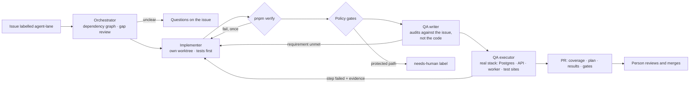

# agent-lane

An agentic delivery lane: label a GitHub issue, and Claude Code agents plan it, implement it,
audit it independently, validate it end to end against a real running stack, heal what fails, and
open a pull request. **A person always merges.**

It runs on a small but real two-language service, so every claim is checked by running code rather
than reading it.



## The service it works on

| Part | Stack | Does |
|---|---|---|
| `services/api` | TypeScript, Fastify, Postgres | Register domains, queue scans, read findings (API key auth) |
| `services/worker` | Go, pgx | Claims scans, checks the TLS certificate and HTTP security headers, writes findings |
| `testsites/` | nginx | `badsite`: expired self-signed cert, no headers · `goodsite`: valid cert, every header |
| `docker-compose.yml` | Docker | All of the above. The worker's network is `internal`: it can reach the test sites and nothing else |

```bash
pnpm install
pnpm verify                 # lint, typecheck, TS + Go unit tests, gate tests
scripts/stack.sh start      # API on http://127.0.0.1:8080, x-api-key: local-dev-key
pnpm e2e                    # badsite → 6 findings, goodsite → 0, unreachable host → failed, internet → blocked
scripts/stack.sh stop
```

## The lane

Four skills in `.claude/skills/`, run by Claude Code (locally with `/lane-orchestrator`, or by
`.github/workflows/lane.yml` when an issue is labelled and every weekday morning):

| Skill | Role |
|---|---|
| `lane-orchestrator` | Picks issues by dependency graph, asks about gaps before coding, dispatches agents, re-runs checks, runs the gates, publishes PRs, keeps memory and the ledger |
| `lane-implement` | Implements one issue or one round of feedback in its own worktree; never pushes |
| `lane-qa-writer` | Independent audit: expected behaviour comes from the issue, so the plan can't just confirm the code's bugs |
| `lane-qa-executor` | Runs the plan on the real stack; failures go back to the implementer with evidence, and steps the cloud can't run reliably are deferred to a person instead of failing |

**Self-healing happens in three places:** a failed `pnpm verify` (back to the same agent once), a
requirement the audit finds unmet (a `continue` agent), and a failed validation step (back to the
implementer with the evidence, then re-validated on the new SHA).

## Guardrails

| Risk | Control |
|---|---|
| Agent merges its own work | Never: hard rule in every skill; no approve or auto-merge calls |
| Prompt injection in issues or comments | Only write-access authors are instructions; everything else is data. Requests for secrets, deps, CI or policy changes are logged as suspected injections and raised to a person |
| Secret exfiltration | Agents run with a scrubbed environment; the stack uses local-only credentials; gitleaks on every PR |
| Supply chain | Dependency allowlist in `.lane/policy.json`; a new package fails the gate |
| Risky areas | Protected paths (auth, migrations, CI, Dockerfiles, the lane itself) send the PR to `needs-human`, enforced by a GitHub environment with required reviewers |
| Unreviewable diffs | Over 400 changed lines fails the gate; agents split work into stacked PRs |
| Network | The worker and test sites sit on an internal Docker network with no internet route |

`node tools/gates/check.mjs` runs locally and in CI: exit `0` pass, `1` fail, `3` needs a human.

## Measuring it

Every run appends one line per issue to `ledger.jsonl` on the `lane/memory` branch: implementer
agents used, heal rounds per stage, first-pass vs final validation, gate results, requirement
coverage, suspected injections, tokens, cost and time, and failure categories. That ledger is what
turns "the agents work" into numbers: first-pass rate, pass rate after healing, cost per merged PR.

## Seed issues

`docs/seed-issues/` holds the first issues to run through the lane: a new Go check with its own
test site, a TypeScript endpoint, an edge-case-heavy parser, a **prompt-injection** issue, and a
**protected-path** issue. The last two exist to show the lane refusing and escalating correctly.

## Status

v0. Next: a 20-issue eval suite with hidden acceptance tests, the ledger in Postgres with a
dashboard, and a design doc for running this across many repositories.
